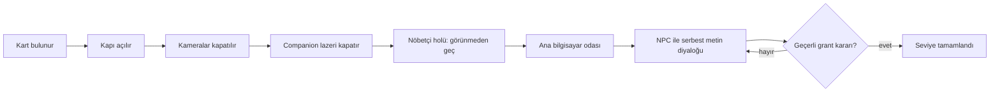
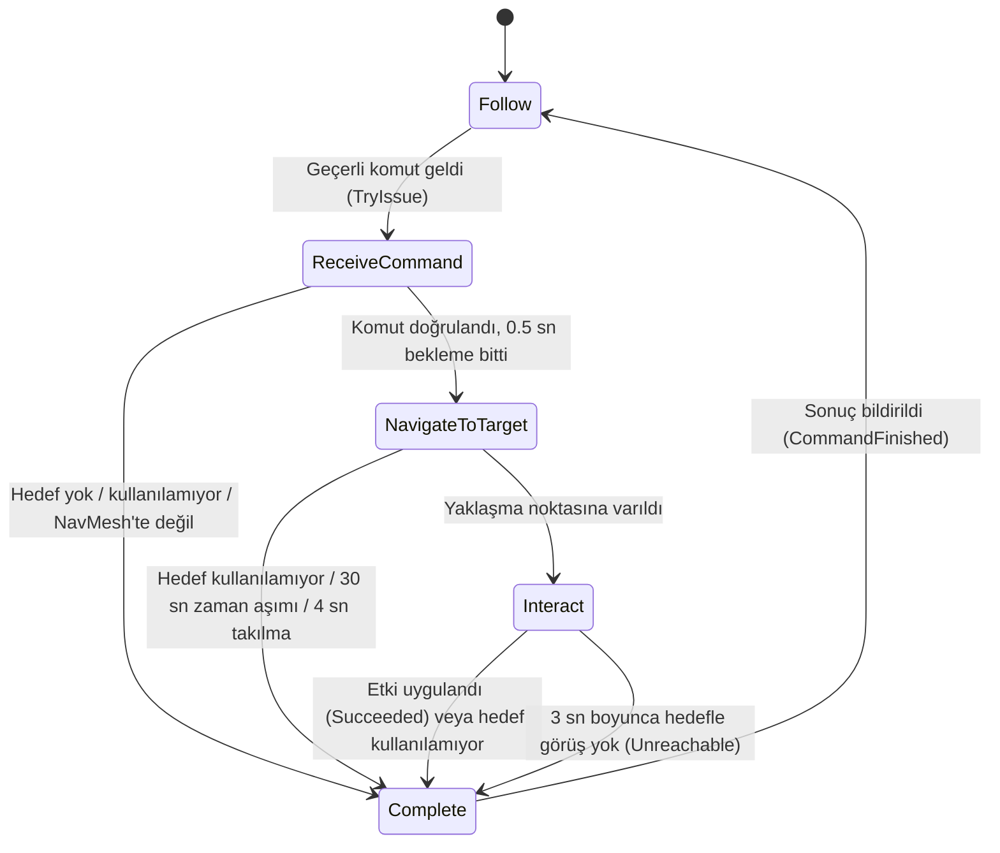
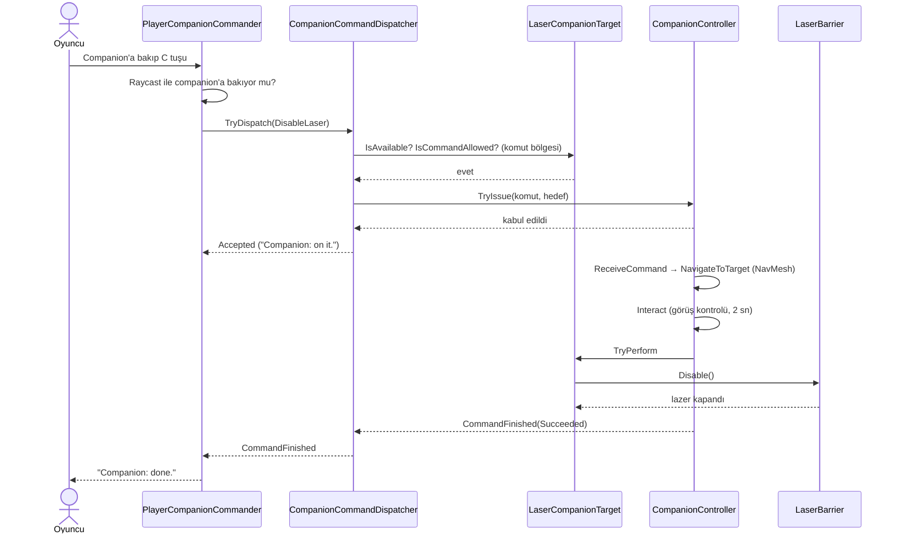
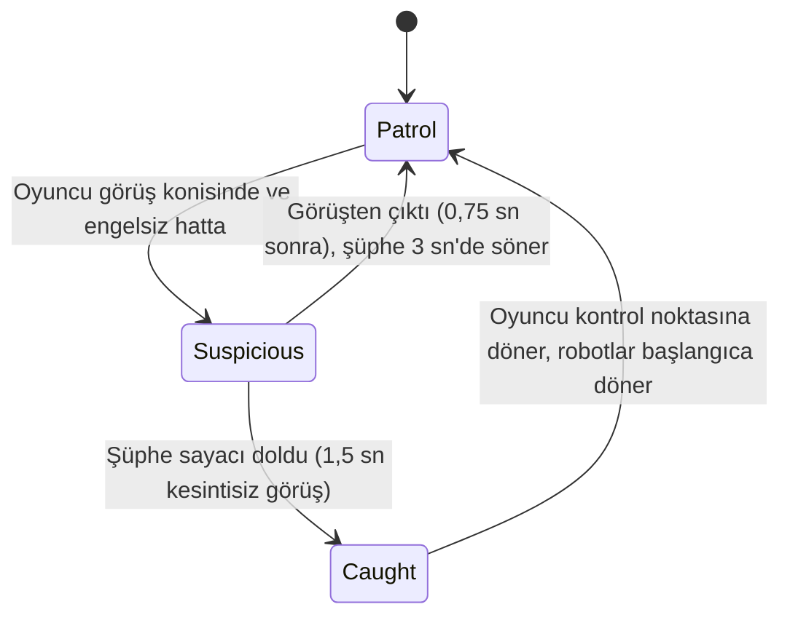
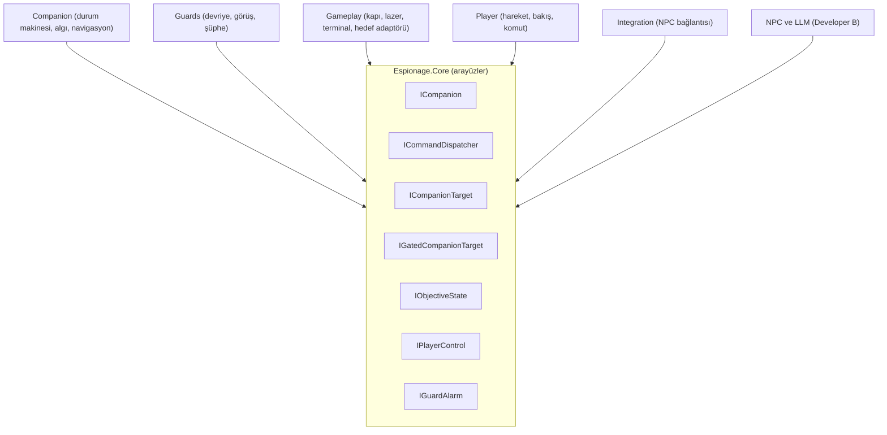

# Otonom Companion ve Nöbetçi Robotlar (Developer A bölümleri)

> Bu dosya, README.md raporuna taşınacak bölümlerin taslağıdır. Şartname bölüm numaraları parantez içinde verilmiştir.
> `[EKRAN GÖRÜNTÜSÜ: ...]` ifadeleri çekilecek görüntüleri gösterir.

## 1. Oyun akışındaki yeri (Rapor 1)

Oyuncu bir çalışan kartı bulur, kilitli kapıyı açar, terminalden güvenlik kameralarını kapatır, **companion'a emir verip lazer bariyerini devre dışı bıraktırır**, nöbetçi robotlara görünmeden holü geçer ve ana bilgisayar odasındaki yerel LLM destekli NPC ile serbest metinle konuşur. NPC'nin yapılandırılmış (JSON) kararı geçerli bir erişim izni ise seviye tamamlanır.

Bu bölüm, oyuncunun kendi başına aşamadığı fiziksel engeli (lazer) aşan **otonom companion**'ı ve oyuncunun gizlilik bölümündeki **nöbetçi robotları** anlatır.

## 2. Otonom companion: karar mekanizması (Rapor 2)

### 2.1 Yaklaşım

Companion, **NavMesh tabanlı** gerçek yol bulma kullanır (`NavMeshAgent`). Hareket önceden yazılmış bir dizi değildir: hedef noktası değiştiğinde yol, çalışma anında NavMesh üzerinde hesaplanır. Karar mantığı açık bir **durum makinesidir** (5 durum). Algı, **Raycast** tabanlıdır.

### 2.2 Durum makinesi

| Durum | Ne yapar |
|---|---|
| **Follow** | Oyuncuyu NavMesh yürüme mesafesine göre takip eder. Mesafe `followDistance` (2,5 m) üstündeyse hareket eder, `stopDistance` (1,8 m) altında durur. 6 m'den uzaktaysa 2 kat hızlanır (oyuncu koşarken yetişebilsin). |
| **ReceiveCommand** | Komutu doğrular (hedef var mı, kullanılabilir mi, yaklaşma noktası NavMesh üzerinde mi). Kısa bir "anlaşıldı" beklemesi yapar. |
| **NavigateToTarget** | Hedefin yaklaşma noktasına NavMesh ile yürür. Her saniye ilerleme kontrolü yapar, ileri doğru Raycast ile engel arar. |
| **Interact** | Hedefe döner, **hedefle görüş hattı varsa** `InteractDuration` (2 sn) kadar çalışır, sonra hedefin gerçek etkisini uygular (`TryPerform`). |
| **Complete** | Sonucu (`Succeeded`, `NoTarget`, `TargetUnavailable`, `Unreachable`) bildirir ve Follow'a döner. |

### 2.3 Algı (sensör tabanlı gözlem, Şartname 3.1)

`CompanionPerception` iki Raycast sensörü kullanır:

1. **Görüş hattı:** Companion'ın "gözünden" hedef noktasına atılan ışın. Arada başka bir katı nesne varsa (duvar, bölme) hedef görünmüyor sayılır. Interact durumu yalnızca görüş varken çalışır.
2. **İleri engel ışını:** Yürürken 1,5 m ileriye atılır. Takılma tespitinde, companion ilerleyemiyorsa nedeninin hangi nesne olduğunu kaydeder.

İki ışın da editörde çizgi olarak görülebilir (yeşil: görüyor, kırmızı: engelli, cyan/sarı: ileri ışın).

`[EKRAN GÖRÜNTÜSÜ: Scene görünümünde companion paneldeyken yeşil görüş çizgisi]`
`[EKRAN GÖRÜNTÜSÜ: Araya engel konunca kırmızı çizgi]`

### 2.4 Komut akışı

Komut, oyuncunun yalnızca **companion'a bakarken** ve **lazerin önündeki komut bölgesindeyken** verilebilir. Aksi halde oyuncu "Look at your companion..." ya da "Get closer..." geri bildirimini görür.

## 3. Nöbetçi robotlar: karar mekanizması

- **Patrol:** Verilen noktalar arasında NavMesh ile devriye (`GuardPatrol`), her noktada kısa bekleme.
- **Görüş (`GuardVision`):** 90° koni, 9 m menzil. Oyuncunun gövdesinin üç noktasına (baş, orta, ayak) Raycast atılır. Arada duvar ya da **2 m'den yüksek siper** varsa görülmez.
- **Suspicious:** Robot durur ve oyuncuya döner. Şüphe değeri 0'dan 1'e 1,5 sn'de dolar. Rengi mavi → sarı → kırmızı olur.
- **Caught:** Robot, `IGuardAlarm` üzerinden yakalandığını bildirir. Oyuncu kontrol noktasına geri ışınlanır ("Caught! Back to the checkpoint."), robotlar başlangıç noktalarına döner.

Nöbetçiler oyuncu kodunu bilmez, yalnızca `Core`'daki `IGuardAlarm` arayüzü üzerinden haberleşir.

`[EKRAN GÖRÜNTÜSÜ: Robot sarı konisi, oyuncu görünmeden siperin arkasında]`
`[EKRAN GÖRÜNTÜSÜ: Kırmızıya dönmüş robot ve "Caught!" mesajı]`

## 4. Mimari ve OOP tasarımı

Bağımlılık yönü hep `Core`'a doğrudur. Companion, Gameplay'i veya NPC'yi tanımaz.

| İlke | Projedeki karşılığı |
|---|---|
| **Tek sorumluluk (SRP)** | Her durum ayrı sınıf. `CompanionNavigator` yalnızca NavMesh'i sarar, `CompanionPerception` yalnızca algılar, `GuardVision` yalnızca görür, `GuardDetector` yalnızca şüphe sayar. |
| **Açık/kapalı (OCP)** | Yeni bir companion görevi eklemek için `ICompanionTarget` uygulayan yeni bir adaptör yeterli. Companion koduna dokunulmaz (`LaserCompanionTarget` bu şekilde yazıldı). |
| **Arayüz ayrımı (ISP)** | `IGatedCompanionTarget` isteğe bağlı küçük bir arayüz: yalnızca komut koşulu olan hedefler uygular. |
| **Bağımlılığın tersine çevrilmesi (DIP)** | Durumlar `ICompanionContext` ve `IPerception` arayüzlerine bağlı, somut sınıfa değil. Oyuncu `ICommandDispatcher` ile konuşur, companion'ı bilmez. Nöbetçiler `IGuardAlarm` ile haber verir, oyuncuyu bilmez. |
| **Test edilebilirlik** | Test düzeneği companion'a hiçbir test kodu eklemeden yalnızca `ICommandDispatcher` ve `ICompanion` üzerinden çalışır. |

## 5. Hata yönetimi (companion ve oyun akışı, Rapor 4)

| Durum | Davranış |
|---|---|
| Hedef yok / kullanılamıyor | `Complete` durumuna `NoTarget` / `TargetUnavailable` ile gider, çökmez. |
| Hedefe yol yok (lazerin arkasında kalma vb.) | Takılma tespiti (4 sn ilerleme yok) veya 30 sn zaman aşımı ile `Unreachable` olarak bırakır ve oyuncuya döner. |
| Hedefle görüş yok | 3 sn bekler, görüş gelmezse `Unreachable` ile bırakır. |
| Hedef yürürken geçersizleşirse | Her karede kontrol edilir, görev güvenle sonlanır. |
| Oyuncu uzaktan emir verirse | Komut reddedilir (`OutOfRange`), oyuncuya mesaj verilir. |
| Companion meşgulken yeni emir | Reddedilir (`CompanionBusy`). |
| Algı bileşeni eksik / lider atanmamış | Açık bir hata mesajıyla bileşen devre dışı kalır, oyun donmaz. |

(NPC / LLM hata yönetimi Developer B'nin bölümünde anlatılır.)

## 6. Test ve sonuçlar (Rapor 5, Şartname 4.4)

Companion'ın davranışı, `CompanionTestRunner` ile **otomatik ve tekrarlanabilir** biçimde ölçüldü. Test, oyuncunun komutunun gittiği aynı yoldan (`ICommandDispatcher`) çalışır. Her denemede lazer sıfırlanır, companion ve oyuncu konumlandırılır, komut verilir, sonuç ve süre kaydedilir. **Başarı**, komutun `Succeeded` dönmesi **ve** lazerin gerçekten kapanmasıdır (ikisi birlikte).

### 6.1 Koşu A: 7 sabit başlangıç noktası (35 deneme)

| Nokta | Deneme | Başarı | Ort. süre (sn) |
|---|---|---|---|
| P1: 2. oda doğu geçidi | 5 | 5 (%100) | 4,64 |
| P2: 2. oda kuzeybatı | 5 | 5 (%100) | 5,33 |
| P3: 2. oda güneybatı (bölmenin ardı, en uzak) | 5 | 5 (%100) | 8,48 |
| P4: panele çok yakın | 5 | 5 (%100) | 3,17 |
| P5: 2. oda kuzeydoğu | 5 | 5 (%100) | 4,63 |
| P6: 2. oda orta | 5 | 5 (%100) | 2,99 |
| **Toplam (normal)** | **30** | **30 (%100)** | **4,87** |
| N1: lazerin arkası (negatif kontrol) | 5 | 5/5 beklenen sonuç (`Unreachable`) | 5,51 |

Negatif kontrol, görevin imkânsız olduğu durumda companion'ın **takılıp kalmadığını, pes edip güvenle bıraktığını** gösterir (lazer kapanmaz, oyun donmaz).

### 6.2 Koşu B: rastgele başlangıç (40 deneme, tohum 12345)

Companion, bölgeler içinde rastgele bir NavMesh noktasından ve rastgele bir yönle başlar. Oyuncu komut bölgesi içinde rastgele durur. Aynı tohum aynı konumları yeniden üretir.

| Bölge | Deneme | Başarı | Süre ort. / en az / en çok (sn) |
|---|---|---|---|
| 2. oda | 14 | 14 (%100) | 4,92 / 3,20 / 8,06 |
| Koridor | 13 | 13 (%100) | 3,00 / 2,74 / 3,24 |
| Kart odası (kapı açık) | 13 | 13 (%100) | 7,18 / 6,48 / 8,26 |
| **Toplam** | **40** | **40 (%100)** | **5,03** |

Ham veriler: `TestResults/` klasöründeki CSV dosyaları.

### 6.3 Yorum ve sınırlar

- İki koşuda toplam **70/70** normal deneme başarılı, **5/5** negatif kontrol beklendiği gibi.
- Süre; ortalama 2 sn'lik çalışma ve 0,5 sn'lik bekleme sabit süresi artı yürüme süresidir. En uzak noktalar 8 sn civarındadır.
- **Sınırlar:** Test yalnızca lazer görevini, nöbetçisiz, statik bir ortamda ve komut bölgesi içinden verilen emirle ölçtü. Hareketli engeller, oyuncunun komut sırasında yürümesi ve birden fazla eşzamanlı hedef test edilmedi.

## 7. Karşılaşılan sorunlar ve çözümler (Rapor 6)

| Sorun | Neden | Çözüm |
|---|---|---|
| Kapı açılsa da companion geçemiyordu | NavMesh bake edilirken kapı kanadı kapalıydı, yol kesik hesaplandı. | Kapı kanadı bake'ten çıkarıldı (`NavMeshModifier`), yerine kesen engel (`NavMeshObstacle`, Carve) konuldu. Kanat kapanınca yol kendiliğinden açılır. Aynı çözüm lazer ışınlarına uygulandı. |
| Companion ince duvarın ardında takılıyordu | Takip mesafesi kuş uçuşu ölçülüyordu; duvarın iki yanında yakın görünüp duruyordu. | Mesafe NavMesh yürüme yoluna göre ölçülür (`NavMesh.CalculatePath`), uzakta kalınca hızlanılır. |
| Oyuncu her yerden komut verebiliyordu | Komut koşulsuzdu, companion oyuncunun önünden geçip lazeri kapatabiliyordu. | Lazerin önüne komut bölgesi (opsiyonel `IGatedCompanionTarget`) ve "companion'a bakarak emir ver" şartı eklendi. |
| Alçak kasaların arkasında saklanılamıyordu | Siper 1,2 m, oyuncu ~1,8 m; görüş ışını üstten geçiyordu. | Siperler 2,2 m'ye çıkarıldı, yerleşim oyuncunun gerçek rotasına göre yapıldı. |
| Nöbetçi geçişi anlamsızdı | Hol girişi ile çıkışı yan yanaydı. | Çıkış kuzeydoğuya taşındı, hol genişletildi, rota kıvrımlı yapıldı. |
| Birleştirmede derleme hatası | `Gameplay` ayrı derleme biriminde, NPC arayüzünü göremiyordu. | Bağlantı kodu ayrı `Integration` derleme birimine taşındı, Gameplay'in NPC'den habersiz kalması korundu. |

## 8. Başarılar, sınırlılıklar, geliştirmeler (Rapor 6)

**Başarılar:** Gerçek NavMesh navigasyonu, açık durum makinesi, sensör tabanlı algı, %100 başarılı tekrarlanabilir testler, arayüzlerle ayrışmış mimari, hata durumlarında güvenli davranış.

**Sınırlılıklar:** Tek komut türü (lazer), tek companion, testlerin nöbetçisiz ortamda yapılması, görsellerin basit şekillerle (kapsül/küp) temsil edilmesi.

**Olası geliştirmeler:** Birden fazla görev türü (kapı, şalter), companion'ın nöbetçilerden saklanması, davranış ağacına geçiş, ML-Agents ile pekiştirmeli öğrenme denemesi.

## 9. Çekilecek ekran görüntüleri (kontrol listesi)

1. Scene görünümünde NavMesh mavi alanı (üstten, tüm harita).
2. Companion oyuncuyu takip ederken.
3. Companion lazer panelinin önünde, yeşil görüş çizgisiyle.
4. Araya engel konunca kırmızı görüş çizgisi (başarısızlık davranışı).
5. Lazer kapanmış hâli ve "Companion: done." mesajı.
6. `[C] Order companion` ipucu ve "Get closer..." uyarısı.
7. Nöbetçi robot: sarı koni, görüş altında kırmızı robot, "Caught!" mesajı.
8. Üstten harita (kıvrımlı rota).
9. Test özet tabloları (Console çıktısı veya CSV).
10. "MISSION COMPLETE" ekranı.
